# oxygen-nonqt

Ports of the KDE Oxygen theme to non-Qt toolkits (GTK and others), so the whole desktop looks consistent alongside Qt/KDE applications.

> **Disclosure:** This project is AI-generated. The code and documentation are written by an AI assistant (Claude) under human direction. Review accordingly.

## Status

Early stage. There are no colour variants: the theme follows the KDE colour scheme and accent colour that KDE's GTK integration exports to `~/.config/gtk-{3,4}.0/colors.css`. Titlebars use the window colour, like Oxygen's window decoration.

- **GTK 3** (`gtk3/`): a regular GTK theme.
- **GTK 4** (`gtk4/`): a regular GTK theme for plain GTK 4 apps.
- **libadwaita** (`gtk4/scss/_libadwaita.scss`): libadwaita apps ignore GTK themes, so `make install` adds one `@import` line to `~/.config/gtk-4.0/gtk.css` that loads Oxygen on top of libadwaita. `make uninstall` removes it again. This layer relies on the colours KDE exports and has no fallbacks of its own.
- **Firefox** (`firefox/`): a `userChrome.css` for the toolbars, tabs (horizontal or vertical), address bar and menus, with Oxygen icons from the system icon theme, and a `userContent.css` for the new tab page. Firefox takes its colours from the GTK theme, so the browser follows the KDE scheme too. Made for Firefox's classic design (the Nova redesign off) in compact density, which the install sets.

Shared colour handling and drawing recipes live in `common/`.

```
make            # needs sassc
make install    # copies to ~/.local/share/themes/Oxygen and hooks up libadwaita
```

Then pick "Oxygen" under System Settings → Colors & Themes → Application Style → Configure GNOME/GTK Application Style.

For Firefox, install into a profile (the directory shown in `about:profiles`) and restart Firefox:

```
make firefox-install PROFILE=~/.mozilla/firefox/xxxxxxxx.default-release
make firefox-uninstall PROFILE=...    # removes it again
```

This puts the theme in the profile's `chrome/oxygen/`, adds one `@import` line each to `chrome/userChrome.css` and `chrome/userContent.css` (existing ones keep their rules) and these preferences to `user.js`:

- `toolkit.legacyUserProfileCustomizations.stylesheets`: load the stylesheets.
- `widget.gtk.libadwaita-colors.enabled = false`: otherwise Firefox replaces light GTK themes' colours with libadwaita's.
- `browser.nova.enabled = false` and `browser.uidensity = 1`: the classic design in compact density.

Firefox's own pages, like the new tab page, only get the real accent colour; the other system colours are replaced by fixed stand-ins so web pages cannot read them. So the install writes the current KDE colours for the new tab page; run it again after changing colour schemes.

Oxygen has no overlay scrollbars. GTK decides that outside the theme, so turn them off to get the classic always-visible scrollbars:

```
gsettings set org.gnome.desktop.interface overlay-scrolling false
```

`tools/compare/` renders the same widgets in Qt Oxygen, GTK 3, GTK 4 and libadwaita, with any KDE `.colors` scheme, for side-by-side checks.

## Screenshots

The comparison windows from `tools/compare/`, in KDE's stock Oxygen and Oxygen Dark schemes. Click for full size. Regenerate them with `tools/screenshots.sh` after `make install`.

| | Oxygen | Oxygen Dark |
|---|---|---|
| **Qt (reference)** | <a href="docs/screenshots/qt-light.png">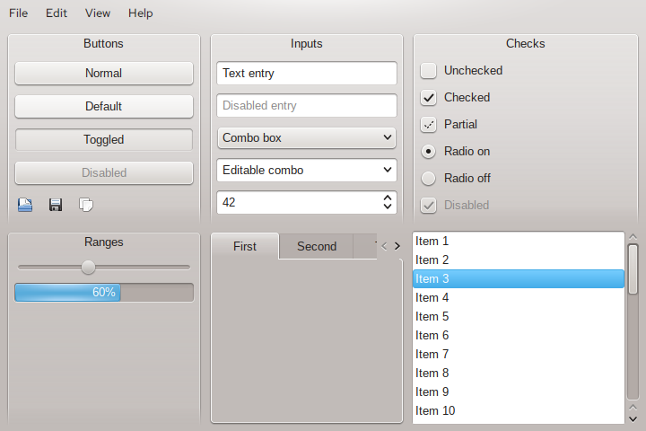</a> | <a href="docs/screenshots/qt-dark.png">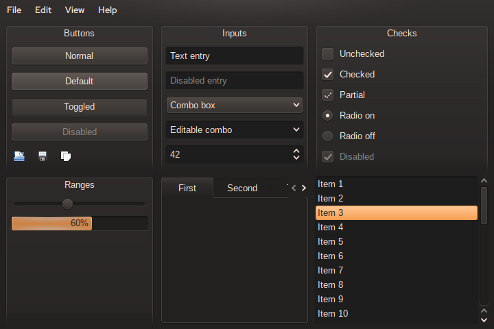</a> |
| **GTK 3** | <a href="docs/screenshots/gtk3-light.png">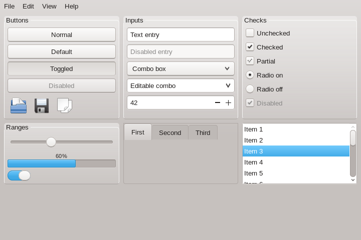</a> | <a href="docs/screenshots/gtk3-dark.png">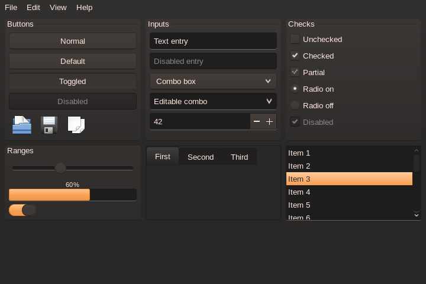</a> |
| **GTK 4** | <a href="docs/screenshots/gtk4-light.png">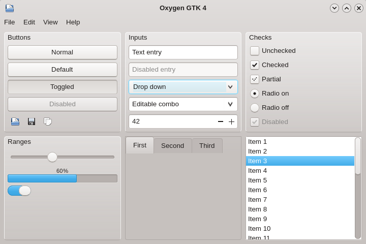</a> | <a href="docs/screenshots/gtk4-dark.png">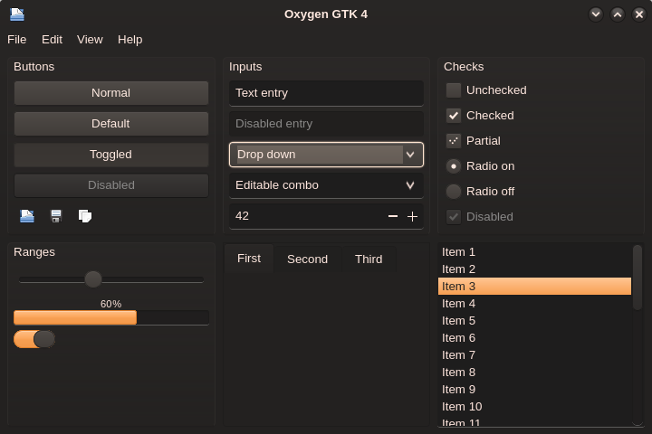</a> |
| **libadwaita** | <a href="docs/screenshots/libadwaita-light.png">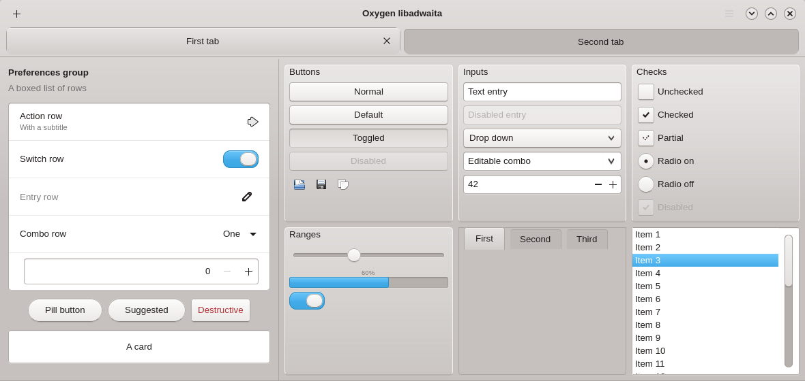</a> | <a href="docs/screenshots/libadwaita-dark.png">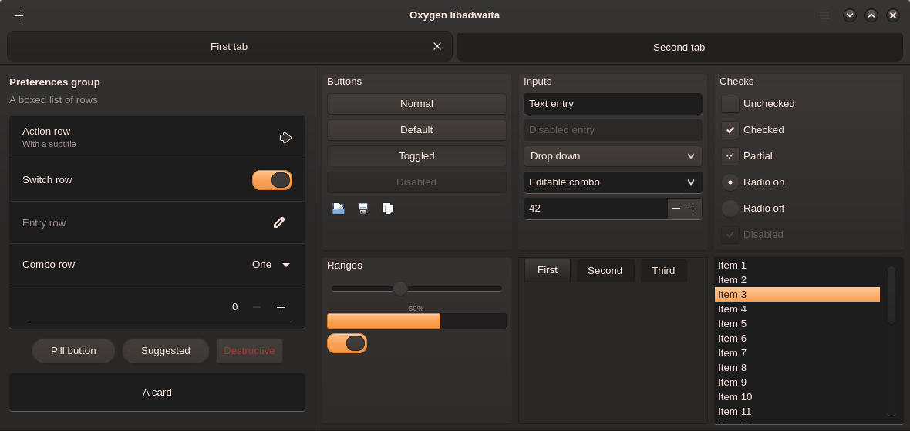</a> |
| **Files (Nautilus layout)** | <a href="docs/screenshots/files-light.png">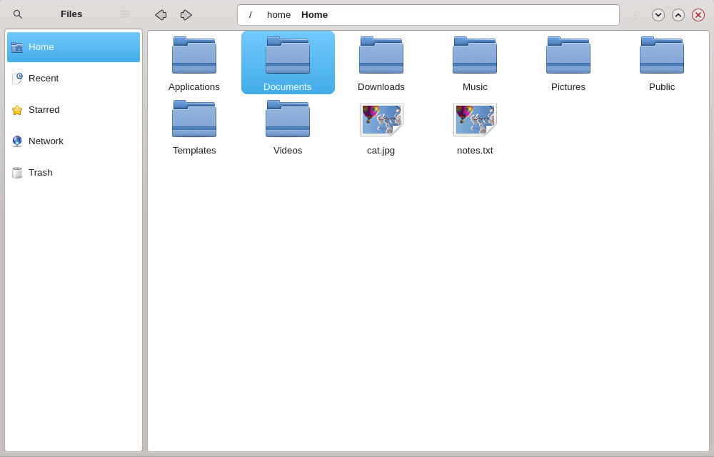</a> | <a href="docs/screenshots/files-dark.png">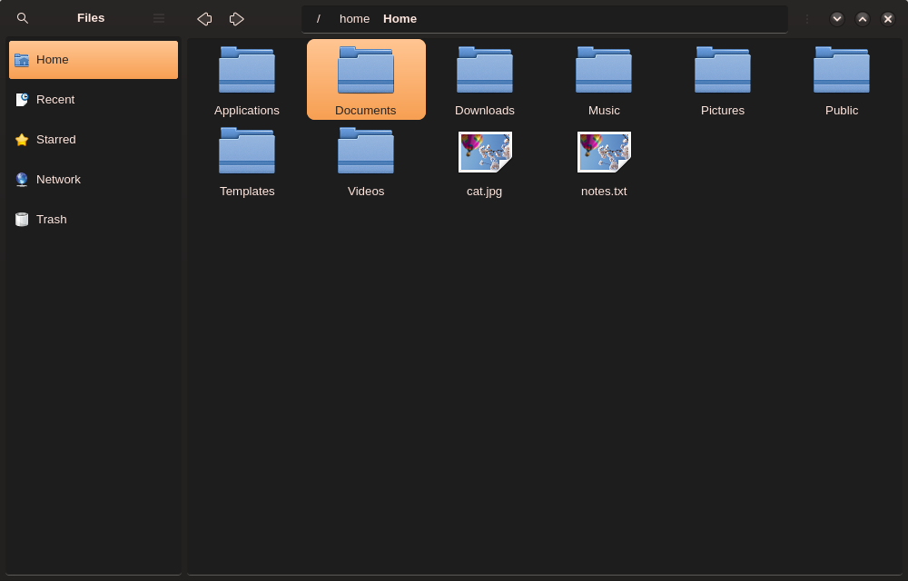</a> |
| **Firefox** | <a href="docs/screenshots/firefox-light.png">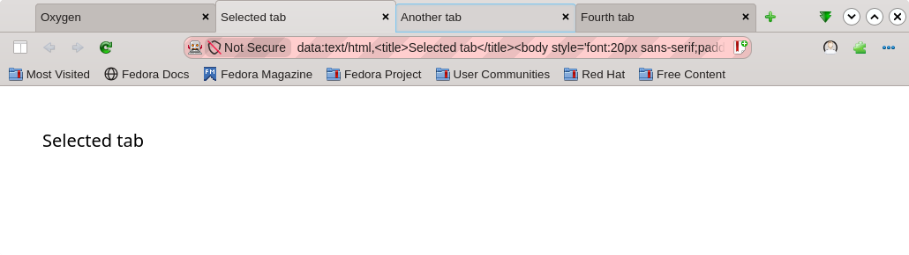</a> | <a href="docs/screenshots/firefox-dark.png">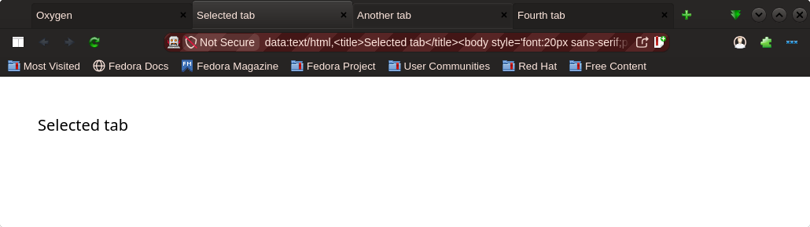</a> |
| **Firefox, vertical tabs** | <a href="docs/screenshots/firefox-vertical-light.png">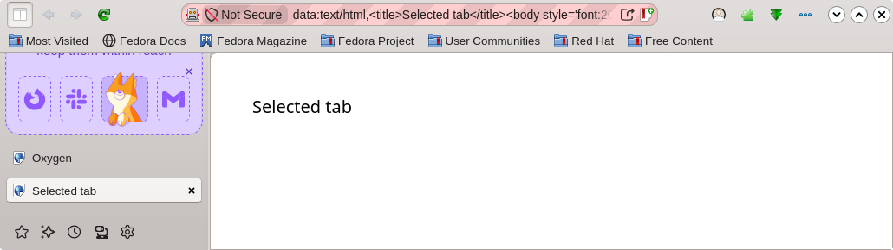</a> | <a href="docs/screenshots/firefox-vertical-dark.png">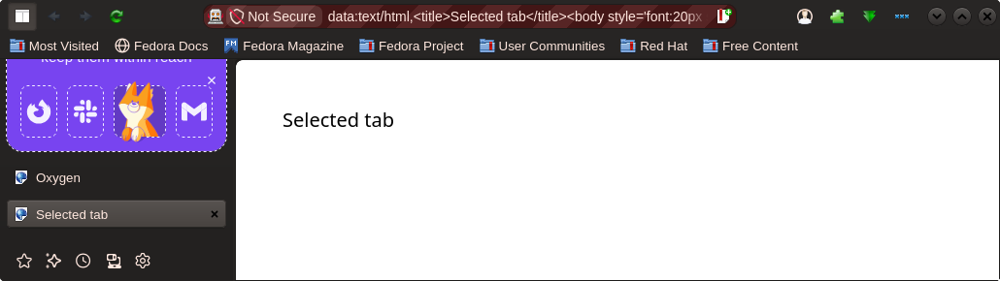</a> |
| **Firefox, new tab page** | <a href="docs/screenshots/firefox-newtab-light.png">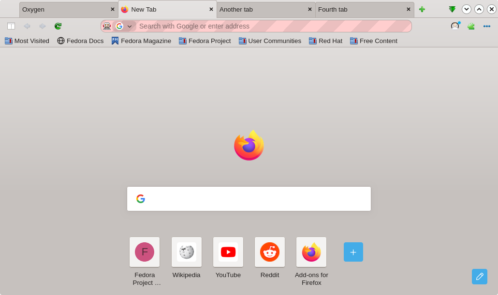</a> | <a href="docs/screenshots/firefox-newtab-dark.png">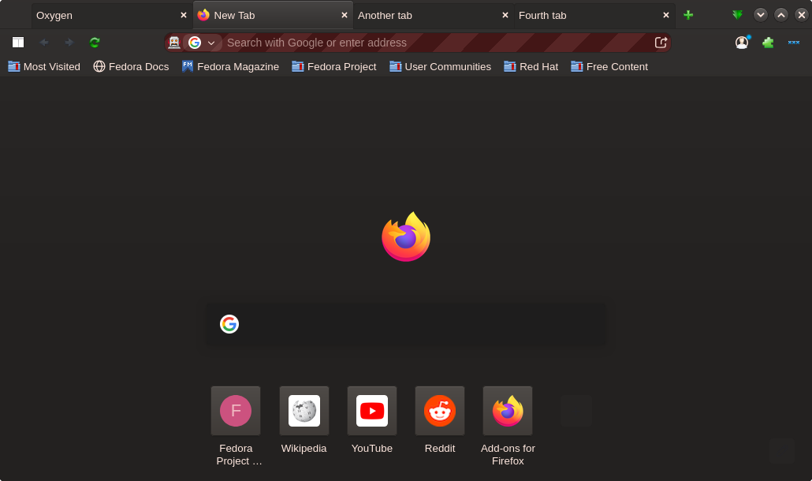</a> |

The Qt and GTK 3 windows are shown without a titlebar, since KWin draws theirs. The libadwaita and Files windows are test mocks built from libadwaita widgets, not the real apps. The striped address bar in the Firefox shots is Firefox marking the window as remote-controlled by the screenshot script, and the third tab is held in its hover state.

## License

GPL-3.0-or-later. See [LICENSE](LICENSE).
